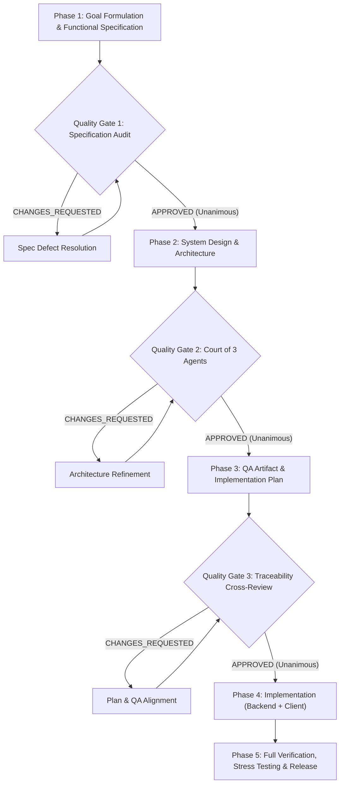

# Autonomous Agentic Development Cycle (Quality-Gated Pipeline)

This skill formalizes the 5-phase engineering workflow and multi-agent arbitration pipeline developed and verified during the autonomous creation of **Quest Nova** (Flutter + Go + PostgreSQL 16 + Drift/SQLite).

It guarantees high architectural fidelity, zero data loss, strict security (Zero-Trust/IDOR), and mathematically verified distributed synchronization without human intervention between phases.

> [!NOTE]
> **Reverse Engineering Excluded:** The reverse-engineering phase is omitted/disabled. The pipeline starts directly with Goal Definition and Functional Specification authoring (or takes an existing product brief as input).

---

## 1. Core Architecture Principles

1. **Zero-Interruption Autonomy:** The orchestrator progresses through all phases autonomously. Confirmation is derived strictly from rigorous Quality Gate audits rather than asking the user.
2. **Clean-Context Independent Verification:** Reviewers and judges are spawned as dedicated subagents with *clean context* (they receive only the verifiable target artifact, reference specifications, and explicit evaluation criteria — free of prior chat reasoning).
3. **Unanimous Approval Barrier:** Transition to the next phase is blocked until all auditors/judges grant an explicit `APPROVED` verdict. Defect lists (`CHANGES_REQUESTED`) trigger an immediate correction-re-audit loop.
4. **Fallback Model Routing:** When primary reasoning models experience rate limits (e.g. HTTP 429 quota exhaustion), the pipeline seamlessly routes tasks to available high-throughput models (e.g., Gemini 3.8 Flash) while strictly preserving agent roles and clean context boundaries.

---

## 2. The 5-Phase Pipeline

---

## 3. Phase-by-Phase Execution Guide

### Phase 1: Goal Formulation & Functional Specification (Quality Gate 1)
- **Objective:** Formulate explicit system boundaries, user loops, domain models, and technical specifications based directly on requirements/brief.
- **Deliverables:**
  - `docs/GOAL.md`: Global system scope, core invariants, Definition of Done (DoD).
  - `docs/SPECIFICATION.md`: Entity schemas, temporal mechanics, sync protocol, OCC versioning, 3-way merge rules, IDOR protection, DDL schemas.
- **Quality Gate 1 (Clean-Context Auditor):**
  - Spawn subagent (`typeName: "research"`).
  - Provide *only* `docs/SPECIFICATION.md` and criteria (completeness, security, data integrity, consistency).
  - Loop until `APPROVED`.

### Phase 2: System Design & "Court of Three Agents" (Quality Gate 2)
- **Objective:** Architect scalable, fault-tolerant backend and reactive client.
- **Deliverable:** `docs/DESIGN.md` (system design document: backend, client, security).
- **Quality Gate 2 (The Court of Three Agents):**
  Spawn 3 independent subagents with clean context:
  1. **Judge 1 (Backend & System Architect):** Evaluates DB schema, transaction boundaries, row-level locks, topological DAG sort, partition schemes, and OCC.
  2. **Judge 2 (Client & UI Architect):** Evaluates Offline-First DB (Drift/SQLite), background isolates, frame budget (< 16.6 ms), mutation queue coalescing, and BLoC state machines.
  3. **Judge 3 (Security & Edge-Case Critic):** Identifies race conditions, cold-start deadlocks, echo loops, token replay (RTR), session theft, and IDOR vulnerabilities.
  - *All 3 judges must return `APPROVED` before proceeding.*

### Phase 3: QA Artifact, Traceability Plan & Quality Gate 3
- **Objective:** Ensure 100% bidirectional traceability between specification, architecture, and tests before writing code.
- **Deliverables:**
  - `docs/QA_ARTIFACT.md`: Complete Acceptance Criteria (`AC-XX`), Unit, Integration, Distributed Sync (`TC-SYNC-XX`), and Stress test scenarios (`STRESS-XX`).
  - `docs/IMPLEMENTATION_PLAN.md`: Staged task breakdown mapped directly to QA cases.
- **Quality Gate 3 (Cross-Auditor):**
  - Verify every single acceptance criteria and edge case in `QA_ARTIFACT.md` maps directly to an implementation step in `IMPLEMENTATION_PLAN.md`.
  - Loop until `APPROVED`.

### Phase 4: Implementation & Test Verification
1. **Database Migrations:** Apply all DDL migrations with composite indexes and partitioning.
2. **Backend Engine:**
   - Clean Architecture: `domain/`, `repository/`, `usecase/`, `delivery/http/`.
   - Unit & integration test execution: `cd backend && go test -v ./...`.
3. **Client Engine:**
   - Core temporal utilities (`PlainDate`, `FloatingTime`, `SparseSortOrder`).
   - 3-Way Differential Merge Engine (5 checklist scenarios, zero-data-loss notes).
   - In-place mutation coalescing & in-flight race handling (`MutationQueueManager`).
   - BLoC architecture & Adaptive UI (Desktop 3-pane + Mobile Navigation).
   - Client test execution: `cd client && flutter test`.
   - Linter verification: `cd client && flutter analyze` (0 issues).

### Phase 5: Stress Testing, Release & Handover
1. **Distributed Sync Verification:** Execute multi-device concurrency, OCC conflicts, Echo suppression, and HTTP 410 Bootstrap reconciliation.
2. **Stress Testing:**
   - Database Connection Pool Saturation (`STRESS-01`): Concurrent workers with 0 pool leaks.
   - UI Frame Budget Benchmark (`STRESS-02`): 1000 tasks processed in < 16.6 ms (stable 60/120 FPS).
3. **Artifact Compilation:**
   - Build native backend binary: `go build -o bin/<service> cmd/<service>/main.go`.
   - Build client bundle: `flutter build bundle` / `flutter build macos` / `flutter build web`.
4. **Release Notes:** Generate `docs/RELEASE_NOTES.md` documenting verified metrics, DoD checklist, and run instructions.

---

## 4. Auditor & Judge Prompt Templates

For prompt templates used when invoking clean-context subagents for Quality Gates 1, 2, and 3, refer to [references/auditor_prompts.md](./references/auditor_prompts.md).
