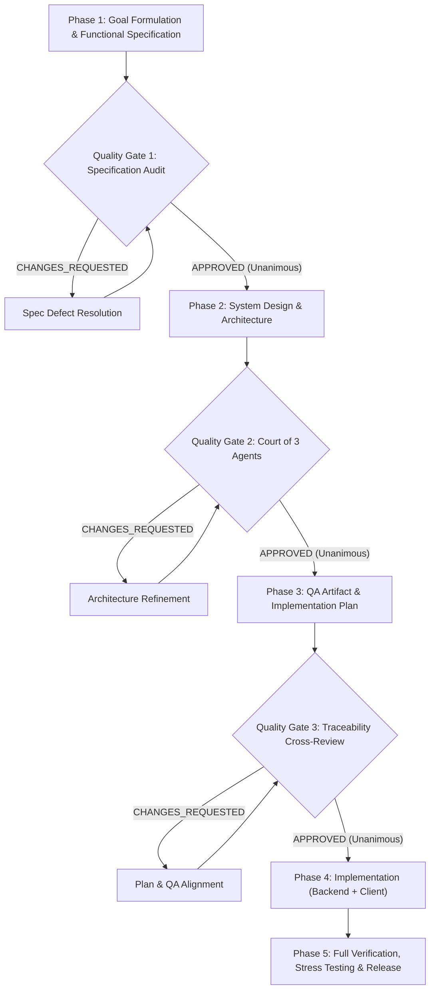

# Autonomous Agentic Development Cycle (Quality-Gated Pipeline)

This skill formalizes the 5-phase engineering workflow and multi-agent arbitration pipeline developed and verified during the autonomous creation of **Quest Nova** (Flutter + Go + PostgreSQL 16 + Drift/SQLite).

It guarantees high architectural fidelity, zero data loss, strict security (Zero-Trust/IDOR), and mathematically verified distributed synchronization without human intervention between phases.

> [!NOTE]
> **Reverse Engineering Excluded:** The reverse-engineering phase is omitted/disabled. The pipeline starts directly with Goal Definition and Functional Specification authoring (or takes an existing product brief as input).

---

## 1. Core Architecture Principles

1. **Zero-Interruption Autonomy:** The orchestrator progresses through all phases autonomously. Confirmation is derived strictly from rigorous Quality Gate audits rather than asking the user.
2. **Clean-Context Independent Verification:** Reviewers and judges are spawned as dedicated subagents with *clean context* (they receive only the verifiable target artifact, reference specifications, and explicit evaluation criteria — free of prior chat reasoning).
3. **Unanimous Approval Barrier:** Transition to the next phase is blocked until all auditors/judges grant an explicit `APPROVED` verdict. Defect lists (`CHANGES_REQUESTED`) trigger an immediate correction-re-audit loop.
4. **Fallback Model Routing:** When primary reasoning models experience rate limits (e.g. HTTP 429 quota exhaustion), the pipeline seamlessly routes tasks to available high-throughput models (e.g., Gemini 3.8 Flash) while strictly preserving agent roles and clean context boundaries.

---

## 2. The 5-Phase Pipeline



---

## 3. Artifact Naming Convention

Every artifact produced by the pipeline is a versioned file. Never overwrite an artifact in place — create the next version instead.

```text
<ARTIFACT-NAME>-<date>-<NN>.md
```

- **`<ARTIFACT-NAME>`** — UPPER_SNAKE name of the artifact: `GOAL`, `SPECIFICATION`, `DESIGN`, `QA_ARTIFACT`, `IMPLEMENTATION_PLAN`, `RELEASE_NOTES`.
- **`<date>`** — creation date in ISO form `YYYY-MM-DD`.
- **`<NN>`** — two-digit sequence number (`01`, `02`, …) that disambiguates artifacts of the same name created **within one day**. Start at `01` on the first artifact of a given day and increment for every subsequent revision of that same artifact on that day. The counter is per artifact name, so different artifacts created on the same day may share the same number (e.g. `GOAL-2026-11-10-01.md` and `DESIGN-2026-11-10-01.md`). On a new day the counter starts again at `01`.

Example:

| Artifact | First artifact of the day | Second artifact of the same day |
|---|---|---|
| Goal | `docs/GOAL-2026-11-10-01.md` | `docs/GOAL-2026-11-10-02.md` |
| Specification | `docs/SPECIFICATION-2026-11-10-01.md` | `docs/SPECIFICATION-2026-11-10-02.md` |
| Design | `docs/DESIGN-2026-11-10-01.md` | `docs/DESIGN-2026-11-10-02.md` |

Rules:
1. Phase deliverables and all cross-references (Quality Gate prompts, plans, release notes) must cite the **exact versioned filename**, never an unversioned name like `docs/GOAL.md`.
2. The highest `<NN>` for an artifact name is the current authoritative version; earlier versions stay untouched as an audit trail.
3. Quality Gates audit the specific version handed to them and record that filename in their verdict.

Throughout this skill `<date>` and `<NN>` stand for the date and sequence number described above.

---

## 4. Phase-by-Phase Execution Guide

### Phase 1: Goal Formulation & Functional Specification (Quality Gate 1)
- **Objective:** Formulate explicit system boundaries, user loops, domain models, and technical specifications based directly on requirements/brief.
- **Deliverables:**
  - `docs/GOAL-<date>-<NN>.md`: Global system scope, core invariants, Definition of Done (DoD).
  - `docs/SPECIFICATION-<date>-<NN>.md`: Entity schemas, temporal mechanics, sync protocol, OCC versioning, 3-way merge rules, IDOR protection, DDL schemas.
- **Quality Gate 1 (Clean-Context Auditor):**
  - Spawn subagent (`typeName: "research"`).
  - Provide *only* `docs/SPECIFICATION-<date>-<NN>.md` and criteria (completeness, security, data integrity, consistency).
  - Loop until `APPROVED`.

### Phase 2: System Design & "Court of Three Agents" (Quality Gate 2)
- **Objective:** Architect scalable, fault-tolerant backend and reactive client.
- **Deliverable:** `docs/DESIGN-<date>-<NN>.md` (system design document: backend, client, security).
- **Quality Gate 2 (The Court of Three Agents):**
  Spawn 3 independent subagents with clean context:
  1. **Judge 1 (Backend & System Architect):** Evaluates DB schema, transaction boundaries, row-level locks, topological DAG sort, partition schemes, and OCC.
  2. **Judge 2 (Client & UI Architect):** Evaluates Offline-First DB (Drift/SQLite), background isolates, frame budget (< 16.6 ms), mutation queue coalescing, and BLoC state machines.
  3. **Judge 3 (Security & Edge-Case Critic):** Identifies race conditions, cold-start deadlocks, echo loops, token replay (RTR), session theft, and IDOR vulnerabilities.
  - *All 3 judges must return `APPROVED` before proceeding.*

### Phase 3: QA Artifact, Traceability Plan & Quality Gate 3
- **Objective:** Ensure 100% bidirectional traceability between specification, architecture, and tests before writing code.
- **Deliverables:**
  - `docs/QA_ARTIFACT-<date>-<NN>.md`: Complete Acceptance Criteria (`AC-XX`), Unit, Integration, Distributed Sync (`TC-SYNC-XX`), and Stress test scenarios (`STRESS-XX`).
  - `docs/IMPLEMENTATION_PLAN-<date>-<NN>.md`: Staged task breakdown mapped directly to QA cases.
- **Quality Gate 3 (Cross-Auditor):**
  - Verify every single acceptance criteria and edge case in `docs/QA_ARTIFACT-<date>-<NN>.md` maps directly to an implementation step in `docs/IMPLEMENTATION_PLAN-<date>-<NN>.md`.
  - Loop until `APPROVED`.

### Phase 4: Implementation & Test Verification
1. **Database Migrations:** Apply all DDL migrations with composite indexes and partitioning.
2. **Backend Engine:**
   - Clean Architecture: `domain/`, `repository/`, `usecase/`, `delivery/http/`.
   - Unit & integration test execution: `cd backend && go test -v ./...`.
3. **Client Engine:**
   - Core temporal utilities (`PlainDate`, `FloatingTime`, `SparseSortOrder`).
   - 3-Way Differential Merge Engine (5 checklist scenarios, zero-data-loss notes).
   - In-place mutation coalescing & in-flight race handling (`MutationQueueManager`).
   - BLoC architecture & Adaptive UI (Desktop 3-pane + Mobile Navigation).
   - Client test execution: `cd client && flutter test`.
   - Linter verification: `cd client && flutter analyze` (0 issues).

### Phase 5: Stress Testing, Release & Handover
1. **Distributed Sync Verification:** Execute multi-device concurrency, OCC conflicts, Echo suppression, and HTTP 410 Bootstrap reconciliation.
2. **Stress Testing:**
   - Database Connection Pool Saturation (`STRESS-01`): Concurrent workers with 0 pool leaks.
   - UI Frame Budget Benchmark (`STRESS-02`): 1000 tasks processed in < 16.6 ms (stable 60/120 FPS).
3. **Artifact Compilation:**
   - Build native backend binary: `go build -o bin/<service> cmd/<service>/main.go`.
   - Build client bundle: `flutter build bundle` / `flutter build macos` / `flutter build web`.
4. **Release Notes:** Generate `docs/RELEASE_NOTES-<date>-<NN>.md` documenting verified metrics, DoD checklist, and run instructions.

---

## 5. Auditor & Judge Prompt Templates

For prompt templates used when invoking clean-context subagents for Quality Gates 1, 2, and 3, refer to [references/auditor_prompts.md](./references/auditor_prompts.md).
